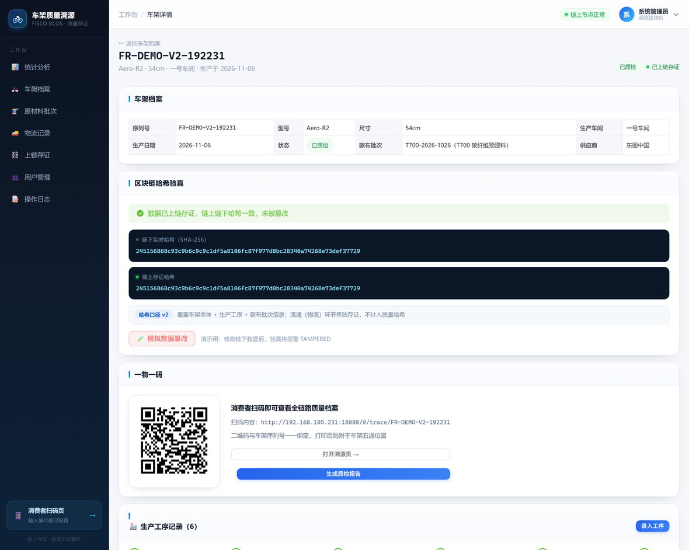
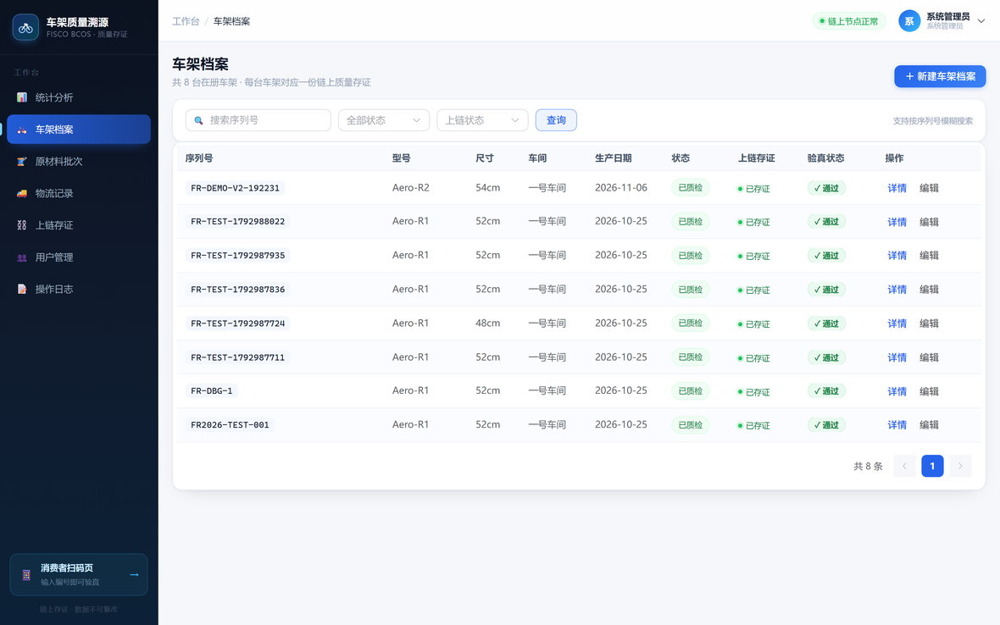
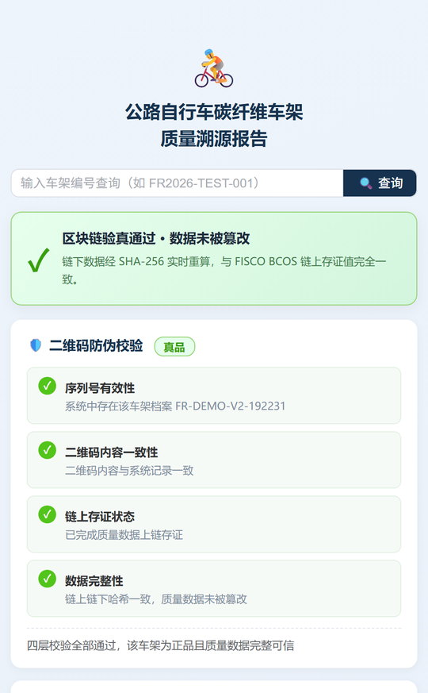
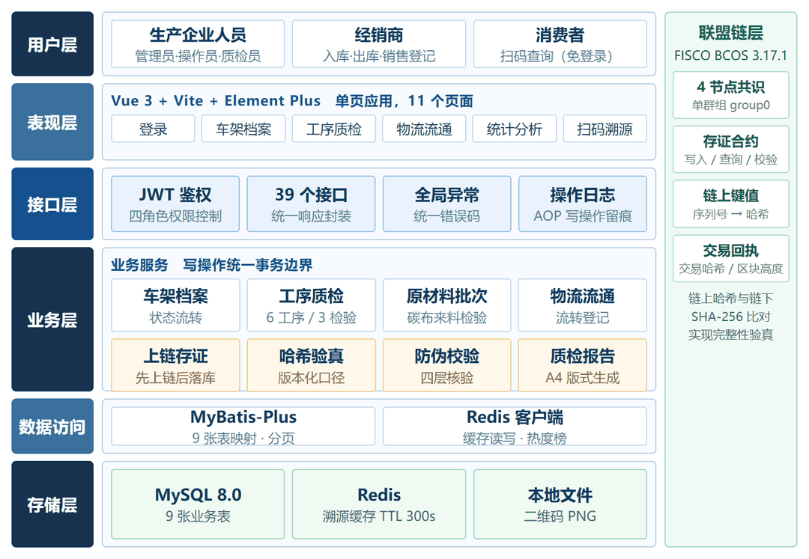

# 公路自行车碳纤维车架质量溯源系统

基于 **FISCO BCOS 联盟链**的车架质量数据存证与溯源系统。核心思路：把车架本体、生产工序、质检结果、碳布原料批次等关键质量数据规范化拼接后计算 SHA-256，将哈希写入联盟链；查询时重算链下实时哈希并与链上存证比对，不一致即判定链下数据被篡改。消费者扫码即可查看全链路档案并独立验真。

> 本科毕业设计（区块链工程专业，2027 届）。代码按可部署标准组织：敏感配置外置、启动即校验密钥、
> 链上链下双向可验。演示账号与默认口令仅适用于本地环境。

## 界面预览

**车架详情与哈希验真** — 链下实时哈希与链上存证哈希并列展示，一致即通过，被篡改立即暴露：



<table>
<tr>
<td width="58%"><b>车架档案列表</b> — 每台车架对应一份链上存证，状态、上链、验真三列一目了然<br>
</td>
<td width="42%"><b>消费者扫码溯源</b> — 免登录，四层防伪校验，输出可读结论<br>
</td>
</tr>
</table>

**系统总体架构**



## 技术栈

| 层 | 选型 |
|---|---|
| 链 | FISCO BCOS 3.17.1（四节点单群组 group0）+ Java SDK 3.x |
| 后端 | Spring Boot 3.2.5 · MyBatis-Plus · Spring Security + JWT · Redis |
| 前端 | Vue 3 · Vite · Element Plus · ECharts |
| 数据 | MySQL 8.0 · Redis 7 |
| 构建 | JDK 17+（开发用 22）· Maven 3.9 · Node 18+ |

## 目录结构

```
.
├── qts-backend/          后端服务（含前端构建产物，打成一个 jar）
│   └── src/main/java/com/qts/
│       ├── controller/   接口层
│       ├── service/      业务层（TraceService 哈希与验真 / AttestService 上链）
│       ├── config/       链配置、安全配置、二维码地址解析
│       └── common/       统一返回、异常处理、哈希工具
├── qts-frontend/         前端工程
├── contracts/            QualityTrace 智能合约（.sol / .abi / .bin）
├── docs/screenshots/     README 界面截图
├── sql/
│   ├── schema.sql        建表脚本
│   └── seed.sql          演示账号与标准原料批次
├── 启动系统.bat          一键启动（Windows）
└── test_e2e.py           端到端流程测试
```

## 快速开始

### 1. 前置条件

- JDK 17 及以上（**注意**：系统 PATH 里的 java 若是 1.8，必须显式指定 JAVA_HOME）
- MySQL 8.0、Redis 7
- Node 18+（仅前端二次开发需要，已打包好的 jar 不需要）
- FISCO BCOS 链已启动（四节点，group0）

### 2. 建库与导入数据

```bash
mysql -u root -p -e "CREATE DATABASE qts DEFAULT CHARSET utf8mb4;"
mysql -u qts -p qts < sql/schema.sql
mysql -u qts -p qts < sql/seed.sql     # 五个演示账号 + 标准碳布批次
```

### 3. 部署合约

用 FISCO BCOS Console 部署 `contracts/QualityTrace.sol`，把返回的合约地址填到
`config/application.yml` 的 `fisco.contract-address`（或直接改
`qts-backend/src/main/resources/application.yml`）。

### 4. 放置链接入证书

SDK 连链需要三个证书文件，它们属于**环境凭证，不在本仓库内**（其中 `sdk.key` 是私钥）。
从你自己的链节点目录复制过来：

```
# 来源
<nodes>/127.0.0.1/sdk/{ca.crt, sdk.crt, sdk.key}

# 目标
qts-backend/src/main/resources/conf/{ca.crt, sdk.crt, sdk.key}
```

### 5. 配置连接地址与密码

数据库密码与 JWT 密钥**不写入版本控制**。复制模板并填入真实值：

```bash
# Windows
copy config\application.yml.example config\application.yml
# Linux / macOS
cp config/application.yml.example config/application.yml
```

`config/application.yml` 已被 `.gitignore` 排除；Spring Boot 启动时自动读取项目根目录下
`./config/application.yml`，优先级高于 jar 内置配置。

也可以改用环境变量（优先级更高）：

| 环境变量 | 含义 | 默认 |
|---|---|---|
| `DB_HOST` / `DB_PORT` / `DB_USER` | MySQL 地址与用户 | 127.0.0.1:3306 / qts |
| `DB_PASSWORD` | MySQL 密码 | 无，**必须配置** |
| `REDIS_HOST` | Redis 地址 | 127.0.0.1 |
| `FISCO_PEER_HOST` | 链节点地址（自动改写 config.toml 的 peers） | 127.0.0.1 |
| `JWT_SECRET` | 签发 token 的密钥，≥32 字符 | 无，**必须配置** |
| `QR_BASE_URL` | 二维码跳转基地址 | `auto`（启动时自动探测本机局域网 IP + 当前端口） |
| `LOG_LEVEL` | 业务日志级别 | `info` |

> `JwtUtil` 在启动时会校验密钥长度，缺失或不足 32 字节直接抛异常退出 —— 避免拖到首次
> 登录才报错，也避免用默认密钥上线后被伪造 token。

### 6. 启动

**Windows 直接双击 `启动系统.bat`**，或命令行（注意在**项目根目录**执行，
否则读不到 `config/application.yml`）：

```bash
java -jar qts-backend/target/quality-trace-system-1.0.0.jar --server.port=18080
```

浏览器打开 <http://localhost:18080/>。

### 7. 演示账号（密码均为 `Qts@2026`）

> 仅用于本地演示。部署到任何可公开访问的环境前，请先改掉这五个账号的口令。

| 账号 | 角色 | 能做什么 |
|---|---|---|
| `admin` | 管理员 | 全部权限，含模拟篡改/恢复 |
| `operator` | 生产人员 | 录入原料批次、车架、生产工序 |
| `qc` | 质检员 | 录入质检结果、发起上链存证 |
| `dealer` | 经销商 | 录入物流流转记录 |
| `xfz` | 消费者 | 扫码查看溯源档案（只读） |

## 重新构建

```bash
# 前端 → 输出到后端 static 目录
cd qts-frontend && npm install && npm run build

# 后端打包（含 22 个单元测试）
cd ../qts-backend && mvn clean package
```

## 功能模块与接口

系统共 8 个业务模块、39 个接口、11 个前端页面：

| # | 模块 | 主要接口 |
|---|---|---|
| 1 | 用户与权限管理 | `/api/auth/login`、`/api/auth/me`、`/api/users/**` |
| 2 | 车架档案管理 | `/api/frames`（分页/新增/修改/删除/状态流转）、`/api/frames/{id}/hash`、`/{id}/tamper`、`/{id}/restore` |
| 3 | 原材料批次管理 | `/api/materials/**` |
| 4 | 生产工序与质检 | `/api/frames/{id}/processes`、`/api/inspections`（新增/修改） |
| 5 | 物流流通管理 | `/api/frames/{id}/logistics` |
| 6 | 区块链存证与验真 | `/api/chain/**`、`/api/frames/{id}/record-onchain` |
| 7 | 二维码溯源 | `/api/qr/{serial}.png`、`/api/qr/{serial}/verify`（四层防伪校验）、`/api/trace/{serial}` |
| 8 | 统计分析与审计 | `/api/stats/overview`、`/api/stats/export`（CSV 台账）、`/api/logs` |

### 质检报告

`GET /api/frames/{id}/report` 返回 A4 版式 HTML（含车架档案、原料批次、工序、质检、链上存证摘要与签字栏），
浏览器打开后 Ctrl+P 可直接打印或另存为 PDF。前端入口在「车架详情 → 一物一码 → 生成质检报告」。

### 二维码防伪校验（四层）

`GET /api/qr/{serial}/verify`，公开接口，逐层校验并给出综合结论：

1. **序列号有效性** — 车架档案是否存在（挡凭空编造的编号）
2. **二维码内容一致性** — 库中内容是否等于系统应生成的内容（挡伪造链接）
3. **链上存证状态** — 是否已完成质量数据上链
4. **数据完整性** — 链下实时哈希与链上存证哈希是否一致

结论分五档：`AUTHENTIC` 真品 / `SUSPECT` 存疑 / `TAMPERED` 数据异常 / `NOT_RECORDED` 未存证 / `NOT_FOUND` 查无此码。

## 性能压测

```bash
python perf_test.py --total 400        # 默认压 http://localhost:18080
```

对「扫码溯源」「二维码防伪校验」「车架详情」三个接口各打 10/50/100/200 并发，
输出 TPS、平均/中位/P95/P99 响应时间与错误率，结果写入 `perf_result.json`，可直接用于论文测试章节。

## 哈希口径说明

参与哈希的数据随版本演进，`frame.hash_version` 记录口径版本，老数据按原口径校验，避免升级后误报篡改：

- **v1**：车架本体 + 生产工序 + 质检记录
- **v2**：在 v1 基础上纳入碳布原料批次（批次直接决定车架力学性能）

物流流转记录**有意不计入质量哈希**：质量哈希覆盖生产环节，流通环节单独存证，两者职责分离。

## 换环境注意事项

1. **JDK 版本**：`java -version` 若是 1.8，启动会报 `UnsupportedClassVersionError`，改 `JAVA_HOME` 或用启动脚本。
2. **局域网 IP 变化**：二维码基地址默认 `auto` 自动探测，换教室 WiFi 无需改配置；若探测不准，用 `QR_BASE_URL` 显式指定。
3. **链上数据不可迁移**：换链后旧的存证记录会失效，需重新上链。`seed.sql` 只导账号和原料批次，不含车架与存证数据。
4. **端口冲突**：18080 被占用时用 `--server.port` 换端口。注意本机后台程序（如播放器）可能抢占 8090/9090 等端口。
